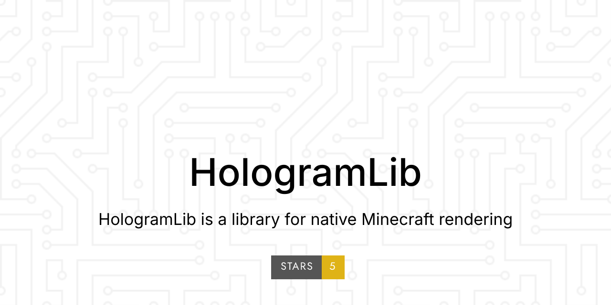

<div align="center">
  
</div>

<!-- Docs site: pushing to main publishes it via .github/workflows/docs.yml to https://ieckseyr.github.io/HologramLib/ -->
[中文](README.md) · [English](README.en.md) · [Docs](docs/index.en.md)

HologramLib folds 18 capability domains for "putting things on a Bedrock client" into one prerequisite-only plugin. A single implementation serves both C++ plugins (frozen pure-virtual interfaces) and LSE scripts (`ll.import`), and everything goes through the protocol layer: no real entities are spawned, nothing is written to the world save, no server-side world state is touched.

> HologramLib is a prerequisite library, not a feature plugin. It provides rendering primitives, protocol wrappers and timing notifications only. Commands, forms, permissions, placeholders and persistence belong to the consumer.

| | |
|---|---|
| Plugin release | `26.51.3` |
| API version | `1.29.0` (`HOLOGLIB_API_VERSION 0x012300`) |
| Platform | LeviLamina 26.51 · BDS 1.26.51 · protocol 2193 |
| Public surface | One public header, `include/hologramlib/HologramLib.h`, plus the LSE namespace `HologramLib` (270 exports registered at runtime) |
| License | MIT (the floating-text "dynamic lines" feature is derived from Phantom and licensed LGPL-3.0) |

> **This release (26.51.3)** ports the `26.40.8` / `26.40.9` / `26.40.10` batches from the 26.40 line onto the 26.51 line (API `1.25.0` → `1.29.0`; `1.28.0` is skipped by the 26.40 line's own convention). The only new 26.51-side change the port needed was `PlayerAuthInputPacketPayload::mInputData`, which becomes `Bedrock::EnumSet<InputData, 66>` (no `operator[]`), so the view-override input mask now reads it with `contains()`. The 26.51 port's existing adaptations (text `LineGapHeight`, `ItemInstance::EMPTY_ITEM()`, container ack `presence=false`, shape NetworkId seed `0x00FFFFFF`) were re-checked after the merge and are all still in place. The build is warning-free and every offline check passes (`view*` 59 items, trade settlement 43, container 42, NPC carrier 32, byte-for-byte PlayerList / trade-offers fixtures; `check-authinput` needs a local capture `logs/authinput.hex` that this workspace does not have).
>
> The LSE surface was verified at runtime as well: scanning all 270 `exportAs` names with `ll.hasExported` resolves all 270 (the two `ghost*` entries used to be unwired and are now wired in).
>
> ⚠ **Not re-verified on 26.51**: the entity-metadata and `AddItemActor`(15) findings of `26.40.9` / `26.40.10` come from **26.40 packet captures**. What was checked here is that the protocol constants are identical on both lines — `sculk/protocol/codec/actor/ActorDataIDs.hpp` and `MinecraftPacketIds.hpp` are byte-identical, and `PrimitiveShapes.hpp` only gains `mLineGapHeight` (emitted by `kTextLineGapHeight`). In-game rendering still needs a 1.26.51 client.

---

## Capability domains

| Domain | C++ interface | LSE prefix | What it does |
|---|---|---|---|
| Shapes | `IShapeDrawer` | `shape*` · 39 | Lines / boxes / circles / spheres / arrows / text; text supports background colour, depth-test toggle and 3-axis rotation |
| Holographic text | `IHologramText` | `holo*` · 26 | Multi-line text as one block: colour / scale / background / depth test / rotation, dynamic lines (content-pool rotation + per-line variables), cross-dimension moves |
| Gradient lines | — | `gradient*` · 11 | Multi-colour gradient trails |
| Item detail | `IItemDetail` | `itemDetail*` · 2 | Translates "diamond x64" for you |
| FMBE item display | `IItemDisplay` | `itemDisplay*` · 33 | "Fox carrying an item"; creation, whitelists, view distance, Molang-driven animation |
| Custom entities | `ICustomEntity` | `entity*` · 37 | Protocol-level entities: poses, equipment slots, animations, ActorLink riding; per-viewer rotation |
| Ghost interaction | Listeners + polling | `ghost*` · 2 | Interaction-event routing for entities that do not really exist (InteractPacket hook; multicast on the C++ side) |
| Particle shapes | `IParticleShape` | `particle*` · 22 | Points / lines / rectangular rings / filled planes / box frames / six-faced / polyhedra, plus moveTo / rotate / spin / follow |
| Fake-player NPCs | `IPlayerNpc` | `playerNpc*` · 29 | Pure-protocol fake players; skin registration from PNG, live capture, directory import, injection (including self-view) and blob persistence |
| Player sensing | `IPlayerSensing` | `sensing*` · 3 | Per-packet client device detection: touch / gamepad / keyboard-mouse / motion |
| Per-viewer appearance | `ICustomEntity` per-viewer overrides | `entity*` tail · 4 | Override nametag / scale / equipment slot for one specific viewer |
| Per-viewer text variables | `IHologramText` + `{var}` | — | Text containing `{var}` becomes a per-viewer shape, so each player sees their own `{player}` |
| Trade menu | `ITradeMenu` | `trade*` · 10 | Opens the vanilla trade UI via `UpdateTrade` (byte-identical to captured BDS packets); display-only by default, `settleLocally` enables protocol-only settlement |
| NPC dialogue | `INpcDialogue` | `npcDialog*` · 9 | `NpcDialoguePacket` plus a synthetic `minecraft:npc` carrier; customisable portrait (built-in skin variants / view-override layering); multi-level routing by scene name |
| Virtual container | `IContainerMenu` | `container*` · 10 | A reimplementation of GMLIB's ChestUI: client-side chest block + block-entity NBT + `ContainerOpen`; 27 or 54 slots; interactive mode lets items actually be dragged around |
| Fake inventory | `IFakeInventory` | `fakeInv*` · 9 | Rewrites the client's view of the player inventory at the protocol layer (the real inventory is untouched); clicks report slot indices |
| Sulfur-cube display | `ISulfurDisplay` | `sulfur*` · 10 | Spawns `minecraft:sulfur_cube` and "swallows" a block in its main hand; the cube is invisible by default, leaving only the block |
| Client view override | `IViewOverride` | `view*` · 18 | Intercepts outbound packets per player (suppress-only): change type / nametag / hide from that player / swap the model while keeping the id / re-type dropped items / fake blocks |

Of the 18 domains, 16 have LSE exports (the 16 prefixes above). The two exceptions point in opposite directions: `gradient*` is LSE-only with no C++ interface, while per-viewer text variables are C++-only with no LSE export.

> The LSE surface registers all 270 `exportAs` calls at runtime. The two `ghost*` entries (`ghostPollInteractions` / `ghostClearInteractions`) used to be missing from the registration path and are now wired in via `ModEntry::exportLseFunctions()`.

---

## Design notes

Interface evolution rules, scope, and the restrictions on the view override domain. Full version: [docs/design-contracts.en.md](docs/design-contracts.en.md).

### Interface compatibility

`IHologramLib` and the domain interfaces gain virtual functions only at the end of the class; existing signatures and semantics do not change. `HOLOGLIB_API_VERSION` is the only version source in code, gated at compile time with `static_assert` and handshaken at runtime with `version()`. Inserting a virtual mid-class moves every vtable slot up, and a consumer then calls the wrong function without an error; since `26.40.9` the header ships a vtable layout descriptor, and the library rejects layout-mismatched consumers at runtime.

### Scope

The library does not write to disk or persist consumer data, and it does not decide when a consumer resends what. It provides timing notifications (such as `setEntitySpawnCallback`) and single-shot primitives (such as `playAnimationTo`); the resend decision and the data source stay in the consumer. To judge whether a new capability belongs in the library, ask whether it would still hold for a different consumer.

### View override

The outbound hook only decides whether a packet goes out; it does not modify fields on the engine's packet object. When content has to change, the library drops the original packet and writes its own protocol packet. Position, rotation and input bits come from inbound `PlayerAuthInput`, spawn packet payloads and `Animate` / `ActorEvent`; server-side entity state is not read.

---

## Thirty-second start

### C++ plugin

```cpp
#include "hologramlib/HologramLib.h"

// Gate the capability at compile time; handshake at runtime in case an older build is installed
static_assert(HOLOGLIB_API_VERSION >= 0x011B00, "requires 1.21.0 (ITradeMenu)");

auto& lib = hologramlib::IHologramLib::getInstance();

// Holographic text: one text shape per block, lines joined with \n, inline colours via § codes
auto holo = lib.holograms().create(0, 70, 0);
lib.holograms().addLine(holo, "§eWelcome to spawn");
lib.holograms().addLine(holo, "Online: {online}");         // {var} resolves per viewer
lib.holograms().setDepthTest(holo, true);                  // true = occluded by blocks (default is see-through)
lib.holograms().draw(holo);

// Shapes: line + colour + lifetime
auto line = lib.shapes().createLine(0, 64, 0, 10, 64, 10);
lib.shapes().setColor(line, 1.0f, 0.2f, 0.2f, 1.0f);
lib.shapes().draw(line);

// Virtual container: a list UI any input device can click (a click is an item pickup)
hologramlib::ContainerMenuSpec menu;
menu.title = "§8Quest list";
menu.rows  = 3;                                            // 3 = 27 slots; 6 = 54 slots
menu.items.resize(27);
menu.items[0].type = "minecraft:diamond_sword";
menu.items[0].name = "§bTrial";
auto menuId = lib.containerMenus().open("Steve", menu);
lib.containerMenus().setItem(menuId, 0, {"minecraft:barrier", 1, 0, "§cDone", {}});
```

xmake integration:

```lua
add_includedirs("../HologramLib/include")
add_linkdirs("../HologramLib/build/windows/x64/release")
add_links("HologramLib")
```

### LSE script
> The standard LSE interfaces (`mc`, `ll`, `logger`, events, NBT, forms, databases …) are covered by the [LSE docs](https://lse.levimc.org/apis/); this section only covers HologramLib's own namespace.

```js
// One namespace, "HologramLib", with 16 domain prefixes
const holoCreate      = ll.import("HologramLib", "holoCreate");
const containerOpen   = ll.import("HologramLib", "containerOpen");
const sensingIsTouch  = ll.import("HologramLib", "sensingIsTouch");

// Route by client device: touch players get the virtual container (clicks always send a packet)
if (sensingIsTouch("Steve")) {
    const id = containerOpen("Steve", "§8Quest list", 3);
    // Drain clicks from a guard/timer loop (reading empties the queue)
    for (const line of ll.import("HologramLib", "containerPollClicks")()) {
        // "player=Steve menuId=1 slot=0 closed=0"
    }
}
```

---

## Installation

1. Stop the server.
2. Extract the release archive `HologramLib.zip` and drop the resulting `HologramLib` folder into the server's `plugins/`, giving `plugins/HologramLib/` (containing `HologramLib.dll` and `manifest.json`).
3. Start the server. Load order does not matter: the library checks during `enable()` and retries on `ServerStarted`.

Consumers only need `getInstance()` in `enable()`; there is no declared dependency to add. The LSE compatibility layer probes for `lrca` at runtime. When it is absent every export call is a safe no-op, and the native C++ interface is unaffected.

> Release builds are completely silent. All diagnostic logging is disabled at compile time and the log strings never enter the binary. To debug, temporarily enable it with
> `xmake f --holo_diag=y && xmake build -y` — and remember to reset it (`--holo_diag=n`) before shipping.

---

## Documentation

Full documentation lives in [`docs/`](docs/index.en.md), also published as a [docs site](https://ieckseyr.github.io/HologramLib/en/) (GitHub Pages, rebuilt on every push to the main branch).

| I want to… | Go to |
|---|---|
| Get it running and write my first feature | [Getting started](docs/getting-started.en.md) |
| Learn how a domain works, including field-tested pitfalls | [Domain guides](docs/domains/README.en.md) |
| Look up a full signature | [C++ API](docs/reference/cpp-api.en.md) · [LSE API](docs/lse/index.en.md) |
| Check version compatibility / ABI breakage | [Version & ABI matrix](docs/versions/api-version-matrix.en.md) |
| Understand the internal layering and runtime cost | [Architecture overview](docs/architecture/overview.en.md) · [Protocol notes](docs/architecture/protocol-notes.en.md) |
| See what changed in a release | [Changelog](docs/versions/changelog.en.md) |
| Contribute to this library | [Design notes](#design-notes) · [Architecture overview](docs/architecture/overview.en.md) |

The documentation set is bilingual: every page under [`docs/`](docs/index.en.md) has a Chinese original and an English version (`<name>.md` / `<name>.en.md`), and the docs site's header switches between the two trees. The two trees are kept in step — if a page exists only in Chinese, please open an issue.

---

## Versions

| Number | Where | Purpose |
|---|---|---|
| Plugin release | `version` in `manifest.json` | For deployment; matches the git tag (e.g. `26.51.3`) |
| API version | `1.29.0` above | Human-readable capability version |
| `HOLOGLIB_API_VERSION` | `include/hologramlib/HologramLib.h` | The only version source in code, `0x012300` |

The full mapping, the encoding rule, and the reasons behind the two documented API shrinks are in the [version & ABI matrix](docs/versions/api-version-matrix.en.md).

---

## License

MIT — see [LICENSE](LICENSE).

The holographic-text "dynamic lines" feature (the `FloatingTextLine` content pool, rotation interval, per-line variable toggle, interval-modulo rotation, 0.5 s throttled refresh with per-player resend, and content deduplication) is derived from [Phantom](https://github.com/GroupMountain/Phantom) (a LeviLamina Bedrock hologram plugin, GNU Lesser General Public License v3.0).

As required by LGPL-3.0, the origin is recorded here: that derived portion and its derivative works are distributed under LGPL-3.0, copyright the Phantom contributors (GroupMountain); the rest of the library remains MIT. Distributing a build that contains that portion means also satisfying LGPL-3.0 — keep the copyright and licence notices, provide the corresponding source (this repository does; origins are marked in the header of `src/FloatingTextManager.h`, above the relevant functions in `src/FloatingTextManager.cpp`, and in this README and `docs/versions/api-version-matrix.en.md`), and keep that portion replaceable / independently rebuildable.
