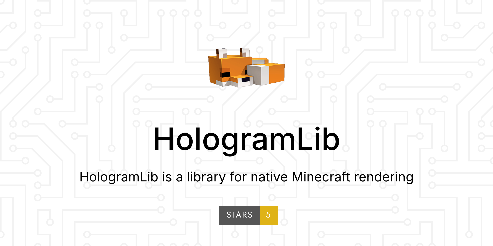

<div align="center">
  
</div>

<!-- 文档站: https://ieckseyr.github.io/HologramLib/ —— 由 .github/workflows/docs.yml 从本仓库 docs/ 构建并发布 -->
[中文](README.md) · [English](README.en.md) · [文档](https://ieckseyr.github.io/HologramLib/)

HologramLib 是基岩版服务端（LeviLamina / BDS）的**协议层显示库**：用一套 API 把形状、悬浮字、物品、实体、菜单这些内容直接「塞」给客户端 —— 不生成真实实体、不写存档、不改服务端世界状态。

同一套能力有两个入口：**C++ 插件**（冻结的纯虚接口）与 **LSE 脚本**（`ll.import`）。

| | |
|---|---|
| 插件版本 | `26.60.1` |
| API 版本 | `1.36.0`（`HOLOGLIB_API_VERSION 0x012A00`） |
| 运行平台 | LeviLamina 26.60 · BDS 1.26.60（协议 2225） / Endstone 0.11（同一 BDS 进程） |
| 对外接口 | 唯一公开头 `include/hologramlib/HologramLib.h`（28 个接口 / 405 槽）+ LSE 命名空间 `HologramLib`（450 个导出）。26.60.1 新增：死亡动画后的复活 `IPlayerRespawn`（补发 `RespawnPacket`，解决客户端卡死亡界面）、容器预览、表现事件阻断，以及 LSE 导出面补全（粒子查询/可见性、真实实体交互事件 `actor*`、`containerUpdate` / `tradeUpdate`）；26.60.0 新增：26.60 平台适配（字段级编码重写、发包审计 `wireTrace*`）+ 假实体 runtimeId 查询 |
| 脚本前置 | `lrca`（LegacyRemoteCall，**可选安装**）：不装时导出调用是安全空操作，C++ 接口不受影响 |
| 许可 | MIT（悬浮字「动态行」重构自 Phantom，按 LGPL-3.0） |

本库是**纯前置库**，不是功能插件：只提供渲染原语、协议封装与时机通知。命令、表单、权限、占位符、数据持久化一律留给消费方。

## 平台与目录

两个加载器共用同一份协议编码（`core/`），平台差异只在最后一步"把字节交给谁"：

```
core/                     平台无关：协议编码 / 形状模型 / 注册表 / C ABI（holo_core.dll）
platform/levilamina/      LeviLamina 原生插件 + LSE 兼容层（HologramLib.dll）
platform/endstone/        endstone Python 插件（hologramlib_endstone + holo_core.dll）
include/hologramlib/      公开契约头（C++ 消费方）
```

一条命令出两个产物：

```bat
build.cmd
::  =  xmake build HologramLib + holo_core   然后 tools/pack_endstone.py
::  产物：HologramLib.dll（LL）  dist/endstone_hologramlib-*.whl（endstone）
```

endstone 侧覆盖除 `swing*` 攻击监听之外的导出（endstone 没有 AuthInput / Animate 入口），其中 **404 个真实生效、40 个受限实现**（返回值或降级路径已在模块 docstring 里逐条写明）：

| 域 | 实现 | 域 | 实现 |
|---|---|---|---|
| 形状 46 · 悬浮字 28 · 渐变线 11 · 粒子 27 | 全部真实 | 物品展示 45 | 39 真实 / 6 记录型 |
| Boss 条 8 · 侧边栏 7 · HUD 5 · 玩家表现 5 | 全部真实 | 自定义实体 47 | 42 真实 / 5 受限 |
| 定位条 14 · 假方块 5 · 物品实体 9 · 硫磺 10 | 全部真实 | 玩家 NPC 55 | 47 真实 / 8 受限 |
| 交易 12 · 虚拟容器 16 · 假背包 10 · NPC 对话 10 | 27 真实 / 13 受限 | View 19 | 15 真实 / 4 受限 |
| 线路诊断 8 · 皮肤注册表 14 · Actor 表现 23 | 全部真实或记录型 | Visibility 5 · Sensing 3 · Ghost 2 | 5 真实 / 5 受限 |

受限的那 40 个分四类（详见 [架构总览](docs/architecture/overview.md#endstone-端状态)）：
入站 `ItemStackRequest` 事务（容器/假背包/交易/对话点击，约 13 个）、出站包改写（`viewSelfType` 等 4 个）、
端侧拿不到的数据（`captureSkin`、`sensing*`、`playerNpcSetRidePlayer` 等，约 9 个）、
引擎侧能力缺失（`playTotem` 换副手、`itemdisplay` 的 molang 缩放，约 14 个）。

`/holo demo` 可直接验证形状 + 悬浮字（逐玩家变量/动态行）+ 彩虹渐变线 + 粒子 + Boss 条 + 侧边栏 + HUD + 玩家效果。（`/holo demo` 可直接验证：3 个形状 + 3 行悬浮字（逐玩家变量 + 动态行）+ 一条彩虹渐变线 + 粒子点/线），其余域按 `platform/endstone/src/hologramlib_endstone/` 里的同一套模式继续补：每域 = core 报文编码 + Python 状态层 + 测试。

## 更新日志
完整更新日志请看
[更新日志](docs/versions/changelog.md)。

# <font size=24>完整文档请见</font>
<font size=16>[HologramLib文档站](https://ieckseyr.github.io/HologramLib)</font>

## 如何编写

### C++ 插件

```cp0
#include "hologramlib/HologramLib.h"

// 编译期门住所需能力域；运行期握手兜住「库被换成旧版」
static_assert(HOLOGLIB_API_VERSION >= 0x011B00, "需要 1.21.0 (ITradeMenu)");

auto& lib = hologramlib::IHologramLib::getInstance();

// 悬浮字：整块一个文本形状，多行用 \n 合并，行内颜色用 § 代码
auto holo = lib.holograms().create(0, 70, 0);
lib.holograms().addLine(holo, "§e欢迎来到主城");
lib.holograms().addLine(holo, "在线: {online}");           // {var} 按观看者解析
lib.holograms().setDepthTest(holo, true);                  // true = 被方块遮挡（默认穿墙可见）
lib.holograms().draw(holo);

// 形状：线 + 颜色 + 生命周期
auto line = lib.shapes().createLine(0, 64, 0, 10, 64, 10);
lib.shapes().setColor(line, 1.0f, 0.2f, 0.2f, 1.0f);
lib.shapes().draw(line);

// 虚拟容器：任何输入设备都能点的列表界面（点击 = 一次物品拾取）
hologramlib::ContainerMenuSpec menu;
menu.title = "§8任务列表";
menu.rows  = 3;                                            // 3 = 27 格；6 = 54 格
menu.items.resize(27);
menu.items[0].type = "minecraft:diamond_sword";
menu.items[0].name = "§b试炼";
auto menuId = lib.containerMenus().open("Steve", menu);
lib.containerMenus().setItem(menuId, 0, {"minecraft:barrier", 1, 0, "§c已完成", {}});
```

xmake 接入：

```lua
add_includedirs("../HologramLib/include")
add_linkdirs("../HologramLib/build/windows/x64/release")
add_links("HologramLib")
```

### LSE 脚本

> LSE 标准接口（`mc` / `ll` / `logger` / 事件 / NBT / 表单 / 数据库…）见 [LSE 文档站](https://lse.levimc.org/zh/apis/)；这里只列 HologramLib 自己的命名空间。

```js
// 统一命名空间 "HologramLib"，23 个分组
const holoCreate      = ll.import("HologramLib", "holoCreate");
const containerOpen   = ll.import("HologramLib", "containerOpen");
const sensingIsTouch  = ll.import("HologramLib", "sensingIsTouch");

// 按客户端设备分流：触屏走虚拟容器（点击必然发包）
if (sensingIsTouch("Steve")) {
    const id = containerOpen("Steve", "§8任务列表", 3);
    // 点击在守护 / 定时里取（取走并清空）
    for (const line of ll.import("HologramLib", "containerPollClicks")()) {
        // "player=Steve menuId=1 slot=0 closed=0"
    }
}
```

## 安装

Lip 安装（推荐）：

```
lip install github.com/Ieckseyr/HologramLib
```

手动安装：

1. 关服。
2. 解压发布包 `HologramLib.zip`，把得到的 `HologramLib` 文件夹整个放进服务端 `plugins/`，最终为 `plugins/HologramLib/`（内含 `HologramLib.dll`、`manifest.json`、`tooth.json`，以及脚本导入层 `lib/`）。
3. 开服。启动顺序没有要求：库在 enable 期检测 LSE 兼容层，没检测到就在 `ServerStarted` 兜底重试。

消费方插件只需在 `enable()` 里 `getInstance()`，不必声明前置依赖。

正式产物完全静默：所有诊断日志编译期关闭，日志字符串不进二进制。排障时临时打开 `xmake f --holo_diag=y && xmake build -y`，发布前复位（`--holo_diag=n`）。


## 版本

| 编号 | 位置 | 用途 |
|---|---|---|
| 插件版本 | `manifest.json` 的 `version` | 部署用，与 git tag 同名（形如 `26.60.1`） |
| API 版本 | 本文档上方的 `1.36.0` | 人读的能力版本 |
| `HOLOGLIB_API_VERSION` | `include/hologramlib/HologramLib.h` | 代码里唯一的版本依据，`0x012900` |

三者的完整对应表、编码规律，以及两次 API 收缩的原因，见 [版本与 ABI 对照](docs/versions/api-version-matrix.md)。

## 许可

MIT 许可（见 [LICENSE](LICENSE)）。

悬浮字「动态行」实现（`FloatingTextLine` 的内容池 / 轮播间隔 / 行级变量开关、按间隔时间取模轮播、0.5s 节流刷新与逐玩家重发、内容去重）重构自 [Phantom](https://github.com/GroupMountain/Phantom)（LeviLamina 基岩版悬浮字插件，GNU Lesser General Public License v3.0）。

依 LGPL-3.0 要求标注来源：该重构部分及其演绎作品按 LGPL-3.0 分发，版权归 Phantom 贡献者（GroupMountain）所有；库其余部分仍为 MIT。分发包含该部分的产物时需同时满足 LGPL-3.0：保留版权与许可声明、提供对应源码（来源位置：`src/FloatingTextManager.h` 文件头、`src/FloatingTextManager.cpp` 相应函数上方标注、本 README 与 `docs/versions/api-version-matrix.md`），并保证该部分可被替换 / 独立重建。
