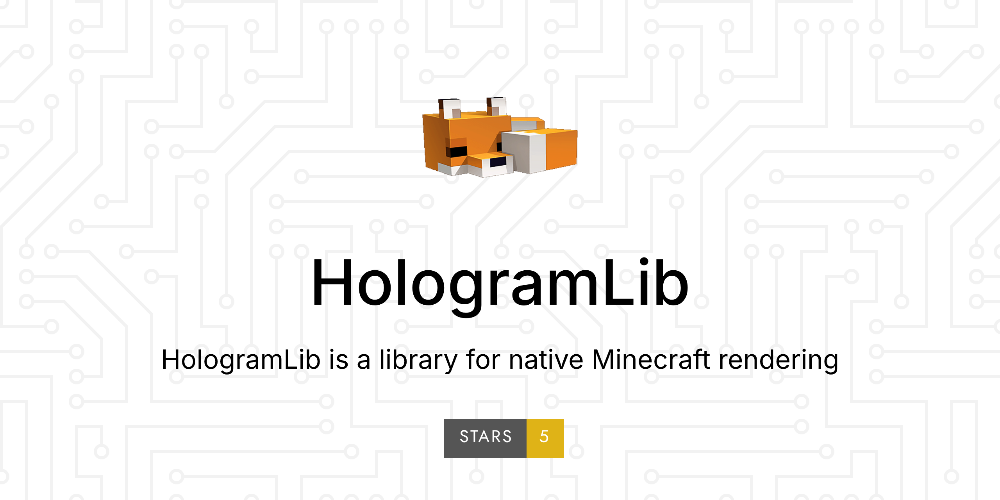

{ width="100%" }

# HologramLib

HologramLib is a **protocol-layer display library** for Minecraft Bedrock dedicated servers: one set of APIs that puts shapes, holograms, items, entities and menus in front of the client — with no real entities spawned, nothing written to the save, and no server-side world state touched.

The same capabilities run on **two platforms**, sharing one protocol encoder (the repo's `core/`):

| Platform | Plugin form | Entry point |
|---|---|---|
| **LeviLamina** | C++ plugin `HologramLib.dll` | C++ interfaces · LSE scripts (`ll.import`) |
| **Endstone** | Python plugin + `holo_core.dll` | Python attributes (`lib.holograms.add_line(...)`) |

This site documents the LeviLamina build; see [Endstone edition](endstone/index.md) for the other one.

| | |
|---|---|
| Plugin version | `26.60.1` |
| API version | `1.35.0` (`HOLOGLIB_API_VERSION 0x012900`) |
| Platform | LeviLamina 26.60 · Endstone 0.11 · BDS 1.26.60 (protocol 2225) |
| Script prerequisite | `lrca` (LegacyRemoteCall, optional) |

---

## Where to start

| You are | Start here | Then |
|---|---|---|
| New to the library | [Getting started](getting-started.md) — build, deploy, first feature | Pick a domain in the [domain guides](domains/README.md) |
| Writing LSE scripts | [LSE scripting API](lse/index.md) — how to import, call and troubleshoot | [Look up functions by domain](lse/index.md) |
| Writing a C++ plugin | [C++ API reference](reference/cpp-api.md) — full signatures for every method | [Domain guides](domains/README.md) |
| Running Endstone | [Endstone edition](endstone/index.md) — install, Python calls, coverage | [Name mapping](endstone/index.md#命名规则) |
| Wondering what a domain can and cannot do | [Domain guides](domains/README.md) | The C++ / LSE pages for that domain |
| Looking for what changed in a release | [Changelog](versions/changelog.md) | — |

---

## What it can do

| Need | Entry point |
|---|---|
| Lines, boxes, spheres, circles, arrows, text shapes | [Shapes `shape*`](lse/shapes.md) |
| Multi-line holograms, rotating content pools, gradient lines | [Holograms & gradient lines `holo*` `gradient*`](lse/holograms.md) |
| "Diamond x64" item detail, 3D item display | [Item display `itemDetail*` `itemDisplay*`](lse/items.md) |
| Protocol-level fake players (NPCs) with skin registration / capture / import | [Fake-player NPCs `playerNpc*`](lse/player-npc.md) |
| Custom entities, particle shapes, interaction events | [Entities, particles & interaction `entity*` `particle*` `ghost*`](lse/entities.md) |
| Trade menu, virtual container, NPC dialogue | [Interfaces & containers `trade*` `container*` `npcDialog*`](lse/interfaces.md) |
| Faking your own inventory, sulfur-cube display | [Inventory & sulfur cube `fakeInv*` `sulfur*`](lse/inventory.md) |
| Reskinning / hiding mobs, reading the client device | [View override & sensing `view*` `sensing*`](lse/view.md) |

All **450 script functions** are listed in the [LSE scripting API](lse/index.md); the matching C++ interfaces (`IShapeDrawer`, `IHologramText`, `ICustomEntity`, `IViewOverride` …) are in the [C++ API reference](reference/cpp-api.md).

---

## Glossary

| Term | Meaning |
|---|---|
| Capability domain / domain | A group of related APIs. One C++ interface, one LSE function prefix (e.g. `view*`) |
| Consumer | A plugin calling this library (C++ or LSE), e.g. MeowHolographicRenderer, MSkinventory |
| Prerequisite library | The library's role: mechanisms only, no business logic. Consumers grab the interface via `getInstance()` in `enable()`; no declared dependency |
| Suppress-only | The view-override discipline: the outbound hook only decides send / drop, it never mutates engine packets |
| Timing notification | A callback the library sends to consumers (e.g. an entity finished spawning for a player); what to resend is the consumer's call |
| Carrier entity | The invisible entity interface domains use (trade menu, NPC dialogue); deleted when the interface closes, never persisted |

---

## Versions

- The three numbering schemes (plugin version / API version / `HOLOGLIB_API_VERSION`) and the per-release capability list are in the [changelog](versions/changelog.md).
- The only version source in code is `HOLOGLIB_API_VERSION` in `include/hologramlib/HologramLib.h`: gated at compile time with `static_assert`, handshaken at runtime via `IHologramLib::getInstance().version()`.
