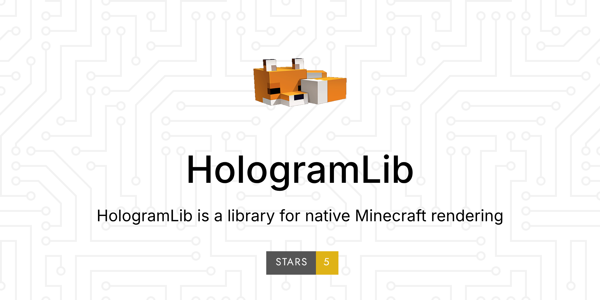

{ width="100%" }

# HologramLib

HologramLib 是基岩版服务端（LeviLamina / BDS）的**协议层显示库**：用一套 API 把形状、悬浮字、物品、实体、菜单这些内容直接「塞」给客户端 —— 不生成真实实体、不写存档、不改服务端世界状态。

同一套能力有两个入口：**C++ 插件**（冻结的纯虚接口）和 **LSE 脚本**（`ll.import`）。

| | |
|---|---|
| 插件版本 | `26.51.5` |
| API 版本 | `1.31.0`（`HOLOGLIB_API_VERSION 0x012500`） |
| 运行平台 | LeviLamina 26.51 · BDS 1.26.51（协议 2193） |
| 脚本前置 | `lrca`（LegacyRemoteCall） |

---

## 从哪开始

| 你是 | 先看 | 再往下 |
|---|---|---|
| 第一次用这个库 | [快速开始](getting-started.md)：编译、部署、第一个功能 | [能力域指南](domains/README.md) 挑一个域 |
| 写 LSE 脚本 | [LSE 脚本接口](lse/index.md)：怎么导入、怎么调用、失败怎么办 | [按域查函数](lse/index.md#7-按域查函数) |
| 写 C++ 插件 | [C++ 接口参考](reference/cpp-api.md)：每个方法的完整签名 | [能力域指南](domains/README.md) |
| 想知道「这个域能做到什么、有哪些坑」 | [能力域指南](domains/README.md) | 对应域的 C++ / LSE 接口页 |
| 看某个版本改了什么 | [更新日志](versions/changelog.md) | — |

---

## 能做什么

| 需求 | 入口 |
|---|---|
| 画线、方框、球、圆、箭头、文字形状 | [形状 `shape*`](lse/shapes.md) |
| 多行悬浮字、动态内容轮播、渐变线 | [悬浮字与渐变线 `holo*` `gradient*`](lse/holograms.md) |
| 「钻石 x64」这类物品详情、3D 物品悬浮 | [物品显示 `itemDetail*` `itemDisplay*`](lse/items.md) |
| 协议层假玩家（NPC），皮肤注册 / 采集 / 导入 | [假玩家 NPC `playerNpc*`](lse/player-npc.md) |
| 自定义实体、粒子形状、交互事件 | [实体、粒子与交互 `entity*` `particle*` `ghost*`](lse/entities.md) |
| 交易菜单、虚拟容器、NPC 对话框 | [界面与容器 `trade*` `container*` `npcDialog*`](lse/interfaces.md) |
| 伪造自己的背包、硫磺立方体展示 | [背包与硫磺立方体 `fakeInv*` `sulfur*`](lse/inventory.md) |
| 给生物换模型 / 隐藏 / 换皮、读客户端设备 | [视图覆盖与感知 `view*` `sensing*`](lse/view.md) |

全部 **273 个脚本函数**见 [LSE 脚本接口](lse/index.md)；C++ 侧对应的接口（`IShapeDrawer` / `IHologramText` / `ICustomEntity` / `IViewOverride` …）见 [C++ 接口参考](reference/cpp-api.md)。

---

## 名词对照

| 词 | 含义 |
|---|---|
| 能力域 / 域 | 一组相关 API。C++ 侧是一个接口，LSE 侧是一个函数名前缀（如 `view*`） |
| 消费方 | 调用这个库的插件（C++ 或 LSE），比如 MeowHolographicRenderer、MSkinventory |
| 前置库 | 本库的定位：只提供机制、不含业务。消费方 `enable()` 时 `getInstance()` 拿接口，不需要声明依赖 |
| 只拦不发 | 视图覆盖域的纪律：出站包只决定「发 / 不发」，不改引擎包内容 |
| 时机通知 | 库发给消费方的回调（如实体对玩家 spawn 完成），补发什么由消费方决定 |
| 载体实体 | 界面域用的隐身实体（交易菜单 / NPC 对话框），界面关掉即删除，不落存档 |

---

## 版本

- 三套编号（插件版本 / API 版本 / `HOLOGLIB_API_VERSION`）的关系与逐版本能力清单见 [更新日志](versions/changelog.md)。
- 代码里唯一的版本依据是 `include/hologramlib/HologramLib.h` 的 `HOLOGLIB_API_VERSION`：编译期 `static_assert` 门住，运行期用 `IHologramLib::getInstance().version()` 握手。
